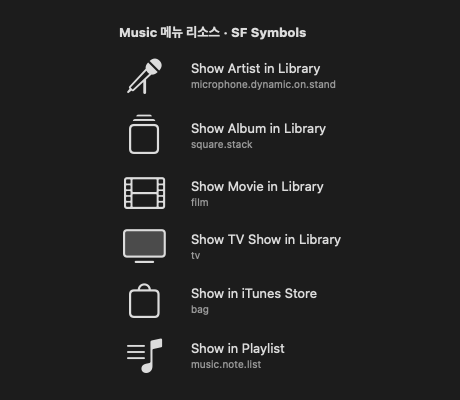

# R189–R190 · 메뉴 리소스 아이콘과 원본 보존

2026-10-15. 개발 소스 1.6.0(30). 앱 설치/공증/바이너리 공개 없이 소스·격리 빌드에서 검증했다.

> R197–R198의1.8.2부터 제목/부모만으로 찾던 연결을 항목 식별자와 전체 경로로 대체했다. 최신 저장·이행 정책은 [1.8.2 기록](1.8.2-fixes.md)에 있다.

## 확정 요청과 구현

- 자동 수집·수동 메뉴 추가 때 앱 리소스 아이콘을 저장한다. 앱 업데이트에는 자동 갱신하지 않는다.
- 자기 앱에 없으면 이미 읽은 다른 앱의 같은 메뉴 이름을 사용하고 출처를 보관한다. 설치된 앱 전체를 상시 탐색하지 않는다.
- 설정 → 메뉴의 선택 앱 목록 위에 **메뉴 아이콘 새로고침**을 추가했다. 기존 메뉴도 이 버튼으로 가져온다. 직접 고른 SF Symbol/아이콘 없음이 우선하며 실패한 항목은 기존 값을 유지한다.
- R190에서 사용자가 벡터/SF Symbol 코드 저장을 요청했다. 초기 128px PNG 통일 구현은 전달 전에 폐기했다. SF Symbol은 이름만, 회수 가능한 PDF는 원본 데이터, 실제 비트맵은 가장 큰 원본 표현을 축소 없이 보관한다. PNG는 비트맵의 무손실 저장용이다. 알 수 없는 표현을 렌더해서 작은 PNG로 만들지 않는다.
- 심볼 코드는 앱 업데이트 때 다시 찾지 않지만 도형 자체는 실행 중인 macOS가 제공한다. OS별 도형 변화까지 동결하는 방식은 아니다.

## 실제 추출 결과

Music 1.7.2의 `MainMenu.nib`에서 NSMenuItem의 NSImage → NSCustomResource 연결을 읽었다. NSOnImage/NSMixedImage(체크 표시)는 대상이 아니다. .strings의 NSKey로 한국어 등 현지화 이름도 연결한다. 런타임 AX에서 이미지를 읽은 결과가 아니며 Music을 실행하거나 화면의 메뉴를 열지 않았다.

| 메뉴 | 리소스 코드 | 결과 |
| --- | --- | --- |
| 보관함에서 아티스트 보기 | microphone.dynamic.on.stand | 공개 SF Symbol |
| 보관함에서 앨범 보기 | square.stack | 공개 SF Symbol |
| 보관함에서 영화 보기 | film | 공개 SF Symbol |
| 보관함에서 TV 프로그램 보기 | tv | 공개 SF Symbol |
| Apple Music에서 보기 | music | 공개 심볼/앱 이미지로 불러오지 못함; 기존 표시 |
| iTunes Store에서 보기 | bag | 공개 SF Symbol |
| 플레이리스트에서 보기 | music.note.list | 공개 SF Symbol |

이 Mac의 약0.41초 측정은 Music 리소스 최초 탐색·현지화 색인 생성 시간이다. utility 큐에서 앱당 첫 메뉴 추가 또는 명시적 새로고침 때 수행하고 결과를 디스크에 보관한다. 오버레이 표시 시간/다른 Mac의 속도를 측정한 것은 아니다.

## 일치·저장 정책

> R191 변경: 저장 위치는 `MenuIcons/v2/apps/<sha256(appID)>.json` 앱별 파일이며 macOS 선호 언어 전체·en-US·앱 개발 언어·저장 메뉴의 언어만 보관한다. 메뉴 이름 별칭도 함께 저장해 앱 언어가 바뀌어도 같은 메뉴로 실행·수집한다. `.nib` 폴더는 폴더 이름으로 번역을 찾고 최신 archive 하나만 읽는다. 아래 v1 index.json 설명은 R189–R190 당시 기록이다.

- 자기 앱의 동일 메뉴 제목·직접 부모 메뉴 일치를 우선한다. 다른 앱에서는 동일 제목만 비교하되 후보 그림이 다르면 자동 선택하지 않는다.
- Unicode 정규화·대소문자·앞뒤 공백만 맞춘다. 번역/부분 일치/말줄임표 제거로 다른 동작을 합치지 않는다. 이 보수적인 모호성 처리 방식은 에이전트의 구현 판단이다.
- `MenuCommand.resourceIcon`에 종류·해시·리소스 이름·출처 앱을 보관한다. 이미지 파일과 앱별 탐색 결과는 `~/Library/Application Support/TileLauncher/MenuIcons/v1`에 저장한다. 심볼은 별도 PNG 파일을 만들지 않는다.
- 설치 앱 경로/mtime/버전 변화로 갱신하지 않는다. 비동기 완료 시 삭제된 메뉴를 되살리지 않고, 사용 기록·단축키·직접 지정은 현재 값을 유지한다. 새로고침은 선택 앱만 갱신한다.
- 제목 색인을 저장소 로딩/탐색 완료 때 만들고 재사용한다. 표시 시에는 저장한 이미지의 메모리 캐시를 사용한다. 찾지 못한 이미지도 캐시하고 새 탐색 완료 때 지운다.

## 지원 범위와 한계

- NIBArchive 형식1/(9·10)의 정적 메뉴-이미지 연결을 해석한다. 형식은 공개 호환성 계약이 아니므로 모르는 형식·손상·과도한 크기는 건너뛴다. 앱의 nib/클래스/코드를 실행하거나 NSKeyedUnarchiver로 앱 객체를 만들지 않는다.
- 동적 메뉴, 코드에서만 지정한 이미지, 다른 형식의 nib/xib, 회수 불가능한 asset 표현, 공개 API에 없는 심볼은 지원하지 않는다. 앱마다 아이콘을 모두 얻을 수 있다고 약속하지 않는다. 자주 쓰는 기본 아이콘·단축키·큰 텍스트가 이어진다.
- 앱별 리소스 탐색·입력 크기·객체 수·이미지 수에 상한이 있다. 전체 설치 앱 탐색/네트워크 다운로드/스크린샷 추출은 없다.
- 형식 참고: [nibsqueeze의 NibArchive 데이터 형식 기록](https://github.com/matsmattsson/nibsqueeze/blob/master/NibArchive.md). 제품 parser는 이 데이터 구조를 직접 구현했으며 외부 parser 패키지/소스 코드는 포함하지 않았다.
- AppKit API 근거: [Bundle.image(forResource:)](https://developer.apple.com/documentation/foundation/bundle/image(forresource:)), [NSImage의 SF Symbol 생성](https://developer.apple.com/documentation/appkit/nsimage/init(systemsymbolname:accessibilitydescription:)), [NSPDFImageRep](https://developer.apple.com/documentation/appkit/nspdfimagerep).

## 검증

- XCTest168개: 기존163개 + 정책/이전 저장 호환/출처·형식 왕복/실제 메뉴 이미지 연결/손상·잘린·변조 archive5개. 400개 변조 입력도 trap 없이 처리했다.
- `--check-menu-icons`: 설치된 Music의 공개 심볼6개, 한국어 연결, 미지원 심볼 fallback, 캐시 재시작/원본 앱 없이 유지, 같은 이름 다른 앱 출처, 새로고침 실패 보존, 자동·수동 추가, 직접 지정 유지, PDF 데이터 바이트 일치, 비트맵512px 보존을 확인했다.
- Python 배포 검사23개, 기존 네이티브 비표시 오버레이/설정 검사를 실행했다. 새 메뉴 버튼은 목록 위에 놓고 기존 메뉴 추가 하단/4개 탭 시작선은 유지한다. 실제 사용자 Mac의 모든 앱/언어/리소스 업데이트 조합을 확인한 것은 아니다.
- 검사 복사본 `/tmp/tile-menu-resources-r189`, 로그 `/tmp/tile-r189-tests.log`, `/tmp/tile-r189-native.log`, `/tmp/tile-r189-previews.log`, `/tmp/tile-r189-release-tests.log`. 진단은 별도 UserDefaults suite/임시 캐시를 사용한다.

위 PNG는 문서용 화면 렌더다. 앱에 저장하는 Music 아이콘은 SF Symbol 코드다.
